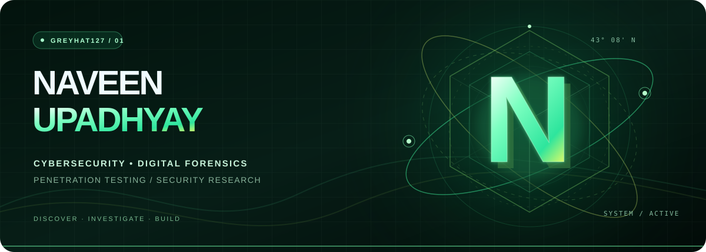

### I investigate systems, explain risk, and build useful tools.

**Penetration testing** · **Digital forensics** · **Web & smart contract security**

[Explore the interactive 3D portfolio](https://naveen-greyhat.github.io/Naveen-GreyHat/) · [LinkedIn](https://www.linkedin.com/in/greyhat127/) · [Email me](mailto:naveenupadhyay8070@gmail.com)

---

I'm **Naveen Upadhyay**, a CompTIA PenTest+ certified security researcher and the founder of **Greyhat127**. My work spans web application testing, digital forensics, bug bounty research, and security tooling. I study **Cyber Security & Blockchain** at Lovely Professional University and bring more than three years of hands-on security experience.

My approach is simple: **find the failure mode, demonstrate its impact clearly, and leave behind something that helps fix it.**

### What I work on

| 01 / Discover | 02 / Investigate | 03 / Build |
| :--- | :--- | :--- |
| Web application assessments, OWASP Top 10, bug bounty research, and DeFi / oracle security. | Digital forensics, incident analysis, traffic inspection, and security monitoring with SIEM / EDR. | Python automation, security research tools, smart contracts, and practical web products. |

### Selected work

| Project | Why it matters |
| :--- | :--- |
| **[Lido V3 oracle research](https://github.com/Naveen-GreyHat/Bug-Bounty-Comp-Lido-V3)** | Documented how stale oracle data could overwrite fresher reports, with an explanation of the downstream reliability risk. |
| **[CTF Flag Search](https://github.com/Naveen-GreyHat/CTF_Flag_search)** | Python automation for finding hidden flags during capture-the-flag challenges. |
| **[PANNA](https://github.com/Naveen-GreyHat/PANNA)** | A local-LLM terminal assistant for chat, code generation, and script workflows. |
| **[Event Registration Smart Contract](https://github.com/Naveen-GreyHat/EventRegistration-Smart-Contract)** | A decentralized event registration concept built with Solidity. |
| **[Corrugated Box Calculator](https://github.com/Naveen-GreyHat/corrugated-box-calculator)** | A real-world cost and profit tool for manufacturing decisions. |

**[See the full portfolio and interact with the 3D security core →](https://naveen-greyhat.github.io/Naveen-GreyHat/)**

### Proof points

- **CompTIA PenTest+** (PT0-003), active September 2026–September 2029; **Quick Heal Certified Digital Forensics Investigator**.
- **Bugcrowd Hall of Fame** recognition for security research.
- **3rd place** at the Cisco Cyber Security Symposium CTF; **7th place** at Republic of Cyber Sentinels CTF.
- **Founder, Greyhat127** — cybersecurity education, tutorials, and research since 2019.

### Experience

<strong>Open experience and education</strong>

| Period | Role | Focus |
| :--- | :--- | :--- |
| 2025–2026 | Penetration Tester · Kreovate Nusa Digital | Web and application security role. |
| 2019–present | Founder & Cybersecurity Educator · Greyhat127 | Security education, research, assessments, and remediation reporting. |
| 2024 | COO & Web Developer · Dharma Group | SIEM/EDR monitoring, security awareness, digital transformation, and a pricing calculator. |
| 2022–2023 | Research Study Assistant & Web Designer · Fundoo Tutor | Educational web pages and digital learning assets. |
| 2022–2023 | SEO & YouTube Intern · Saral Bharat | Search optimization and analytics. |
| 2022–2023 | Video Content Creation Intern · ProgrammingKnowledge | Ubuntu and Kali Linux tutorials. |

**Education:** B.Tech (Hons.) in Computer Science Engineering, Cyber Security & Blockchain · Lovely Professional University · 2023–2027.

### Toolkit

Python · JavaScript · Solidity · SQL · Django · Flask · Linux · Burp Suite · Wireshark · Metasploit · Git · SIEM / EDR

---

**Let's connect:** [LinkedIn](https://www.linkedin.com/in/greyhat127/) · [Email](mailto:naveenupadhyay8070@gmail.com) · [Website Risk & Revenue Audit](https://naveen-greyhat.github.io/website-audit/)

Security research is conducted on owned, lab, bug bounty, or explicitly authorized targets.
