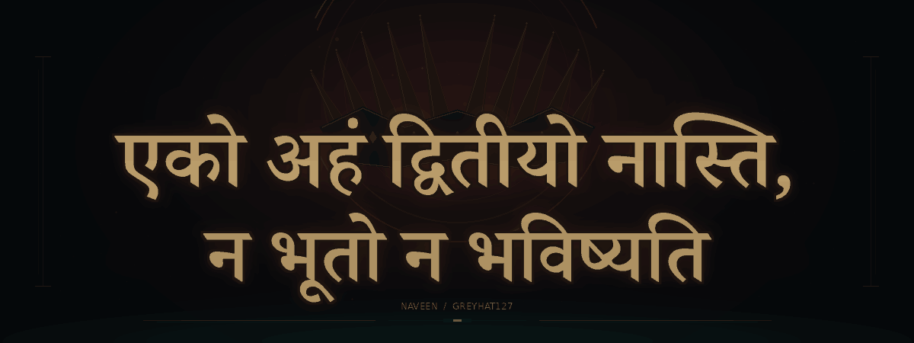
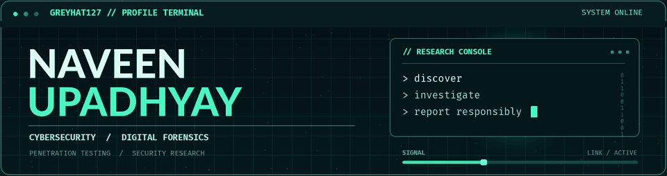
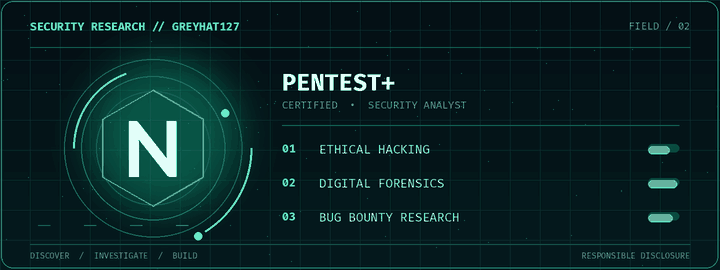
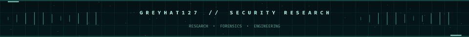
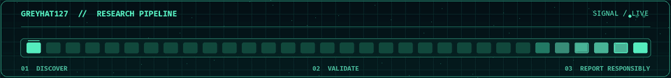

 

<h1>Naveen Upadhyay</h1>

<h2>एको अहं द्वितीयो नास्ति, न भूतो न भविष्यति</h2>

**CompTIA PenTest+ certified** · **Bugcrowd Hall of Fame** · **Founder of Greyhat127**

[Explore my interactive 3D portfolio](https://naveen-greyhat.github.io/Naveen-GreyHat/) &nbsp;•&nbsp; [LinkedIn](https://www.linkedin.com/in/greyhat127/) &nbsp;•&nbsp; [Email](mailto:naveenupadhyay8070@gmail.com)

---

## 0x01 / WHOAMI

I'm **Naveen Upadhyay**, a cybersecurity and digital forensics analyst with 3+ years of hands-on experience across web application security, penetration testing, bug bounty research, and smart contracts. I turn findings into clear evidence, practical fixes, and tools that make the next investigation faster.

I founded **Greyhat127** to share hands-on security education and research. I'm pursuing a **B.Tech (Hons.) in Cyber Security & Blockchain** at Lovely Professional University.

## 0x02 / SELECTED WORK

These are the projects I would open first in a technical conversation:

| Work | The problem and my approach |
| :--- | :--- |
| **[Lido V3 oracle research](https://github.com/Naveen-GreyHat/Bug-Bounty-Comp-Lido-V3)** | Analyzed report monotonicity and documented how stale oracle data could overwrite fresher data in a DeFi system. |
| **[CTF Flag Search](https://github.com/Naveen-GreyHat/CTF_Flag_search)** | Built Python tooling to speed up flag discovery during capture-the-flag challenges. |
| **[PANNA](https://github.com/Naveen-GreyHat/PANNA)** | Built a local-LLM terminal assistant for chat, code generation, and script workflows. |
| **[Event Registration Smart Contract](https://github.com/Naveen-GreyHat/EventRegistration-Smart-Contract)** | Designed a decentralized registration workflow with Solidity and Hardhat. |
| **[Corrugated Box Calculator](https://github.com/Naveen-GreyHat/corrugated-box-calculator)** | Translated manufacturing pricing needs into a usable cost and profit tool. |

<a href="https://naveen-greyhat.github.io/Naveen-GreyHat/"><strong>VIEW THE FULL INTERACTIVE PORTFOLIO ↗</strong></a>

 

## 0x03 / PROOF OF WORK

| Recognition & credentials | Experience |
| :--- | :--- |
| **CompTIA PenTest+ (PT0-003)** — active Sep 2026–Sep 2029 **Quick Heal Certified Digital Forensics Investigator** **Bugcrowd Hall of Fame** recognition **3rd place** — Cisco Cyber Security Symposium CTF **7th place** — Republic of Cyber Sentinels CTF | **Penetration Tester**, Kreovate Nusa Digital · 2025–2026 **Founder & Cybersecurity Educator**, Greyhat127 · 2019–present **COO & Web Developer**, Dharma Group · 2024 **B.Tech (Hons.) CSE**, Cyber Security & Blockchain, LPU · 2023–2027 |

<strong>More experience and competitions</strong>

- **Fundoo Tutor** — Research Study Assistant and Web Designer, 2022–2023.
- **Saral Bharat** — SEO and YouTube Intern, 2022–2023.
- **ProgrammingKnowledge** — Video Content Creation Intern for Linux tutorials, 2022–2023.
- IIT Jodhpur CTF offline-round participant with Team Greyhat127; Binary Blitz Web Hackathon finalist at LPU.

## 0x04 / TOOLKIT

| Offensive security | Forensics & defense | Development & blockchain |
| :--- | :--- | :--- |
| Web application testing · OWASP Top 10 · Burp Suite · Metasploit · Kali Linux | Digital forensics · Wireshark · incident analysis · SIEM · EDR | Python · JavaScript · Solidity · SQL · Django · Flask · Linux · Git |

## 0x05 / CONNECT

**Have a security research, forensics, or engineering problem worth solving?** [Email me](mailto:naveenupadhyay8070@gmail.com), connect on [LinkedIn](https://www.linkedin.com/in/greyhat127/), or explore the [3D portfolio](https://naveen-greyhat.github.io/Naveen-GreyHat/).

Security work is performed on owned, lab, bug bounty, or explicitly authorized targets.
